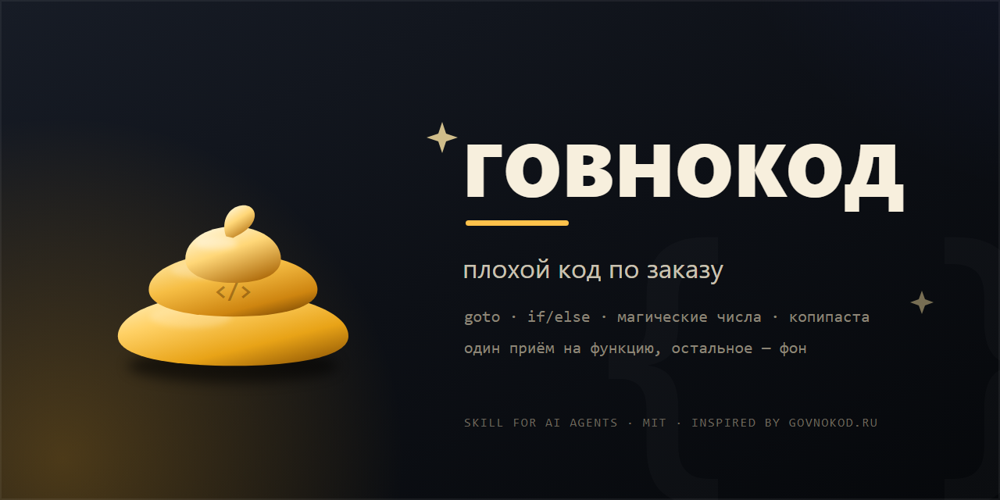

<p align="center">
  
</p>

<p align="center">
  <a href="LICENSE"></a>
  
  
  
</p>

<h1 align="center">Говнокод</h1>

<p align="center">
  Скилл для AI-агентов, который умеет писать <b>намеренно плохой</b> код —<br>
  с <code>goto</code>, вечными <code>if/else</code>, магическими числами и комментариями, которые врут.
</p>

---

## Что это

«Говнокод» — это режим для агента: по явной просьбе он пишет код так, как
его пишут в самых тёмных углах легаси. Не «неудачно», а **осознанно плохо**:
одна идея, доведённая до абсурда, и абсолютная уверенность автора в своей
правоте.

Это не «сломай проект» и не «напиши вирус». Код работает, запускается,
иногда даже выдаёт правильный ответ — и именно поэтому смешно.

```
ГОВНОКОД №0481 · Python · уровень 3/5 · «Флаги вместо логики»
Валидатор возраста для формы регистрации. Работает. Не спрашивай как.
```

## Зачем

- **Шутка.** Иногда нужно объяснить коллеге, что такое «плохой код», — проще
  показать, чем рассказать.
- **Обучение.** Антипаттерн, который можно запустить и потрогать, запоминается
  лучше, чем список в презентации.
- **Фикстуры.** Тесты линтеров, правил ревью и «детекторов запаха» нуждаются
  в образцах. Этот репозиторий — генератор таких образцов.
- **Терапия.** Посмотреть на чужую боль и выдохнуть.

## Установка

Скилл — это папка с `SKILL.md` внутри. OpenCode находит её в
`~/.config/opencode/skills/` (глобально) или `.opencode/skills/` (в проекте).

**Глобально, одной командой** (PowerShell):

```powershell
git clone https://github.com/<your-username>/govnokod.git "$env:USERPROFILE\.config\opencode\skills\govnokod"
```

**Или вручную:** скопировать папку так, чтобы получилось
`~/.config/opencode/skills/govnokod/SKILL.md`.

**Или подключить как каталог** в `opencode.json`:

```jsonc
{
  "$schema": "https://opencode.ai/config.json",
  "skills": ["./vendor/govnokod"]
}
```

Проверка: спросить агента «какие скиллы тебе доступны» — в списке должен
появиться `govnokod`. Если нет — см. [Troubleshooting](#если-скилл-не-виден).

## Использование

Скилл **не включается сам**. Он спрятан от автоподхвата
(`metadata.opencode/autoinvoke: false`), поэтому загружается только тогда,
когда пользователь этого хочет:

```
@govnokod напиши валидатор email
```

или обычной фразой:

```
наговнокодь парсер CSV, уровень 2
```

Агент загрузит `SKILL.md`, выберет язык, уровень и приём, а в ответе будет:

| Часть ответа | Что там |
| --- | --- |
| Паспорт | `ГОВНОКОД №0481 · Python · уровень 3/5 · «название болезни»` |
| Код | рабочий, запускаемый, с 1–2 «якорными» приёмами |
| Разбор | 3 пункта: что именно плохо и как это называется |
| Ревью | одна фраза «что скажет ревьюер» |
| Выход | предложение показать нормальную версию |

### Уровни

| Ур. | Название | Что внутри |
| --- | --- | --- |
| 1 | Первый день | `if (x == true)`, `data2`, отладочный `print` |
| 2 | Джун после курсов | магические числа, `else { return; }`, врущий комментарий |
| 3 | Боевой легаси | 6 уровней вложенности, God-функция, N+1 |
| 4 | Энтерпрайз | `AbstractFactoryFactory`, пустые `catch`, `switch` на 40 кейсов |
| 5 | Легенда | `goto`, самодельный `mod` через цикл, `Thread.Sleep` как синхронизация |

Уровень 5 — это не «больше мусора», а одна идея, доведённая до конца.
Хороший пятый уровень читается как притча. Плохой — как свалка.

### Как выключить

`хватит`, `а теперь нормально`, `no jokes`, `это прод` — режим выключается
с этой же строки. После выключения агент один раз предложит чистую версию
последнего куска и дальше будет писать нормально.

## Пример

<details>
<summary><b>examples/registration_checker.py</b> — уровень 3/5, индекс 62/100</summary>

```python
def check(user):
    global ok, result, temp
    ok = False
    temp = user
    if user:
        if "name" in user:
            if len(user["name"]) > 2:
                if user["name"] != "":
                    if not user["name"] == "":
                        if "@" in user.get("email", ""):
                            if user.get("age", 0) >= 17:   # 17 — так надо
                                ok = True
                                result = "OK"
                            else:
                                result = "too young"
```

Запускается, проходит «тесты на глаз», и только на седьмом уровне вложенности
начинаешь понимать, что `temp` не нужен, а `ok` — тем более.

</details>

## Оценка результата

В комплекте — `scripts/shame_score.py`: эвристический «индекс говнокода»
(0–100) и звание. Только стандартная библиотека Python.

```console
$ python scripts/shame_score.py examples/registration_checker.py
Говнокод-индекс: 62/100 — «Говнокодер»
Файл: examples\registration_checker.py
Уважаемо. Ревьюер плачет, но код живой.

Найдено приёмов: 6
  +20  вложенность 8 уровней x8  ->  early return
  +14  except: pass  ->  не глотать ошибки
  +7   нумерованные имена (data2) x4  ->  назвать по смыслу
  +6   сравнение с true  ->  if (x)
  +4   имена-заглушки x4  ->  доменное имя
  +3   print вместо логгера x4  ->  logger
```

Есть `--json` для автоматизации и чтение из stdin (`-`). Шкала честная:
сам скрипт набирает **29/100** — «Джун после курсов».

## Что внутри

```text
.
├── SKILL.md                  # сам скилл: контракт, уровни, формат ответа
├── references/
│   ├── techniques.md         # 64 приёма с примерами и пометками уровней
│   ├── languages.md          # диалекты: PHP, JS, Python, Java, C#, C/C++,
│   │                         # SQL, Bash, 1С, Pascal, Go, Rust и ещё немного
│   └── gallery.md            # 20 разборов классики с govnokod.ru
├── scripts/
│   └── shame_score.py        # индекс говнокода 0–100
├── examples/                 # два образца: Python и JavaScript
├── assets/                   # logo.svg/png, banner.svg/png
├── README.md
└── LICENSE
```

`SKILL.md` — точка входа. Агент читает его и по ссылкам догружает нужный
reference. Всё остальное — вспомогательное.

## Безопасность

Скилл сделан так, чтобы его нельзя было «случайно применить»:

- **Нет автозапуска.** `opencode/autoinvoke: false` — скилл не попадает в
  список доступных модели, пока пользователь не позовёт его через
  `@govnokod`. Чтобы включить автоподхват, удалите блок `metadata` в
  `SKILL.md`.
- **Песочница.** Код пишется в чат или в новую папку `govnokod/`, но никогда
  в существующие файлы проекта, миграции, тесты или CI.
- **Красные линии.** Никаких бэкдоров, кражи токенов, обфускации,
  «полезных» эксплойтов и шуток в криптографии, платежах и безопасности.
- **Секреты — `***`.** Как на govnokod.ru: реальные ключи и домены
  вымарываются.
- **Один приём на функцию.** Если смешно каждую строку — это уже не шутка,
  а мусор. Скилл это прямо запрещает.

Если попросить «наговнокодить» реальный рабочий файл, агент откажется и
предложит показать пример в песочнице отдельно от чистой версии.

## Как это сделано

Перед написанием скилла было просмотрено **~70 постов govnokod.ru** на PHP,
JavaScript, C#, Java, Python, SQL, 1С и C (снимок — ноябрь 2026). Двадцать
самых показательных разобраны в [`references/gallery.md`](references/gallery.md).

Вывод, который лёг в основу скилла: у всех двадцати разобранных примеров
общее не синтаксис, а **исчезнувшее ревью**. Автор был уверен в своей
правоте, ошибка была одна, но проходила через весь код, и код при этом
работал. Поэтому скилл учит не «писать глупости», а воспроизводить
уверенность — и добавлять один приём туда, где его никто не ждёт.

Спасибо сообществу [govnokod.ru](https://govnokod.ru) за двадцать лет
документирования человеческой природы. Репозиторий с сайтом не связан.

## Ограничения

- Это **не** инструмент качества кода. Индекс — эвристика на регулярках,
  он ошибается и не заменяет линтер.
- Режим не для продакшена, не для обучения джунов «как надо» и не для
  пассивной агрессии в ревью.
- Скилл не гарантирует, что шутка зайдёт. Юмор — штука вероятностная,
  в отличие от `NullPointerException`.

## Если скилл не виден

1. Проверьте путь: должен быть `.../skills/govnokod/SKILL.md`, а не
   `.../skills/govnokod.md`.
2. ID скилла — имя папки (`govnokod`), а не `name` из frontmatter.
3. Скилл скрыт от автоподхвата — зовите его явно: `@govnokod`.
4. Проверьте права: `permissions` с `action: "skill"` и `effect: "deny"`
   на `govnokod` скроют его совсем.

## Лицензия

[MIT](LICENSE). Делайте что хотите, только не в проде.